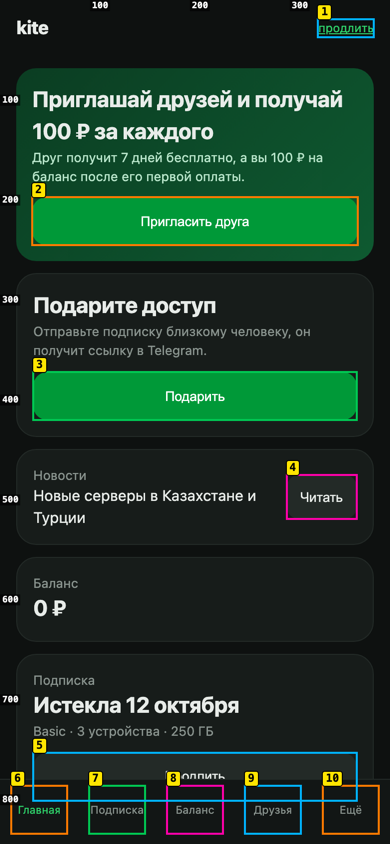
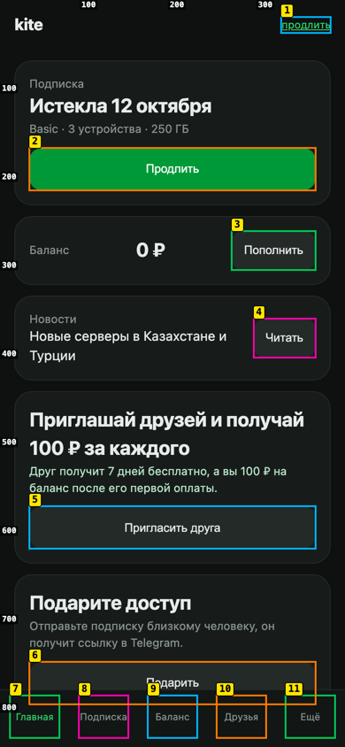

# bestux

An AI agent skill for **zero-friction screen arrangement**: put every element where the user expects it, so the task takes the fewest, most obvious steps.

A screen can be beautiful and still make people work. Friction almost always comes from **where things are**: the action the user came for sits under a promo, the status and its fix live on different cards, the confirm button is at the top of a list the user just scrolled to the bottom of. `bestux` finds that with measurements and a blind first-click test, rearranges the blocks, and proves the new layout is easier.

Sibling of [taste](https://github.com/enkinvsh/taste) (visual design and motion). `bestux` does not touch colors, fonts or animation; it owns placement, order, grouping, the primary action per user state, reach, steps and consistency.

Works with OpenCode, Claude Code, Cursor, Windsurf, Cline and any agent supporting `SKILL.md` / [skills.sh](https://skills.sh). The blind test needs a multimodal model call with zero project context (`look_at` in OpenCode, or a fresh subagent).

## Install

```bash
# Install to current project
npx skills add enkinvsh/bestux

# Install globally
npx skills add enkinvsh/bestux -g
```

Or copy `skills/bestux/` into `.agents/skills/bestux/` (or `~/.agents/skills/bestux/`).

**On demand only.** If you do not want the skill description in every session, keep the folder outside the skill loader (for example rename `SKILL.md` to `BESTUX.md`) and install the slash command instead: copy `commands/bestux.md` to `~/.config/opencode/command/` (OpenCode) or `~/.claude/commands/` (Claude Code), point its first step at your path, and run `/bestux <screen or route>`.

The probe needs Node 18+ and `playwright` or `playwright-core` resolvable from the audited project, from `BESTUX_NODE_MODULES=/path/to/node_modules`, or from the skill folder. It falls back to a locally installed Chrome when Playwright browsers are missing.

---

## Why it exists

Agents arrange screens badly for three predictable reasons:

1. **Data order instead of task order.** Blocks follow the API response or the component tree, not the order a person needs them.
2. **Asking a model for opinions.** "What UX improvements can be made?" is mostly noise: in [Baymard's test](https://baymard.com/research-articles/gpt-ux-audit) GPT-4 was right in 19.9% of its suggestions and found 25.5% of the issues visible in the screenshots. GPT-4o found 21.2% of the issues experts found ([arXiv 2506.16345](https://arxiv.org/abs/2506.16345)).
3. **Judging geometry by eye.** A model looking at a screenshot cannot reliably tell distances, sizes, overlap or what is below the fold.

So the fresh-eye model is never asked what to improve. It **acts** like a hurried first-time user, and the agent scores what it does. Geometry is measured by a script.

## The pipeline

**Task Map -> Measure -> Blind First-Click -> Arrange -> Prove**

1. **Task Map.** Per screen and user state (weighted by how many users are in it): the top 1-3 tasks written as situations, never with the button's words, and the ONE primary action.
2. **Measure** with `scripts/ux-probe.mjs` (Playwright) at `390x844`, `320x568` and `1440x900`. It writes a clean shot, a blurred "squint" shot, and a Set-of-Mark shot where every interactive element has a yellow number and the edges carry a 100px ruler. Gates fail the run:
   - primary action missing, below the fold, out of thumb reach, smaller than 44px, or covered by a fixed bar;
   - last content hidden under a bottom bar, targets under 24px (WCAG 2.5.8), horizontal overflow;
   - a task path that breaks or does not finish.

   Signals flag competing primaries, an outshouted primary, tight gaps, more than 7 choices on the first screen, placeholder-as-label, wrong mobile keyboard, focus order jumps, scrolls inside a task and elements that drift between screens.
3. **Blind First-Click.** A zero-context model gets the numbered screenshot and a situation, and answers in four lines: `CLICK` (mark number), `WHY`, `DOUBT` (the other mark it almost pressed), `EYE` (first, second, third thing noticed). Three reworded runs in fresh contexts; pass = the intended mark in at least 2 of 3 on every viewport, with no probe gate on that target. No self-reported confidence: models are overconfident, behavior is the metric. Separate calls for squint, comprehension and after-click walkthrough.
4. **Arrange** by an evidence-backed rulebook: one job per state, task order, status next to its action, confirm where the work ends, group by use, size as importance, thumb reach ([Hoober](https://www.uxmatters.com/mt/archives/2017/07/design-for-fingers-touch-and-people-part-3.php)), same element in the same place, fewer and clearer steps, forms, empty states, progressive disclosure, focus order. The new arrangement is prototyped in the DOM first (`prototype` in the probe config), before any source edit.
5. **Prove.** Probe at 0 gates, first-click again in fresh contexts, and a pairwise "which is easier" comparison run in **both orders** with a `LOSS` field that names anything the user can no longer find. Adding or removing features, blocks or text is always the owner's decision. At most two rounds: model feedback gets worse with each iteration.

## Example

`examples/expired-home/`: a phone home screen of a subscription service in the most common state, "subscription expired". Run it with `python3 -m http.server 5291` in that folder and `node skills/bestux/scripts/ux-probe.mjs --config examples/expired-home/probe.json`.

<table>
<tr><th>Before</th><th>After (DOM prototype)</th></tr>
<tr><td></td><td></td></tr>
</table>

| | Probe | Blind first-click ("the paid period ended, you want the service back") |
|---|---|---|
| Before | Primary "Продлить" 33% covered by the bottom nav, at 92% of the screen height; below the fold at 320px; a 56x17 duplicate link; two green promo buttons outshout it | Picked the tiny header link; eye landed on the referral promo first |
| After | Primary at 23% of the height, full width, nothing competing; only the duplicate link remains (owner's call) | Picked the intended button; doubt: "balance is 0, maybe top up first?" |

The pairwise test preferred the new layout in both orders, and its `LOSS` field caught a block that a hand-made "good" variant had silently dropped.

## What is inside

```
skills/bestux/
  SKILL.md                     the method
  scripts/ux-probe.mjs         Playwright probe: marks, squint, gates, task walks, prototypes
  references/rulebook.md       arrangement rules with sources and checks
  references/monkey-protocol.md  blind test prompts (Russian and English), scoring, evidence
  references/probe-config.md   probe config, steps, outputs, gates
commands/bestux.md             optional /bestux slash command
examples/expired-home/         before / after / prototype fixture
```

The probe's `summary.md`, its messages and code comments are in Russian; the prompts in `monkey-protocol.md` come in Russian and English.

## Evidence

- Baymard, GPT-4 UX audit: https://baymard.com/research-articles/gpt-ux-audit
- GPT-4o vs experts on Nielsen heuristics: https://arxiv.org/abs/2506.16345
- UICrit, few-shot and coordinate references improve LLM UI critique: https://arxiv.org/abs/2407.08850
- Set-of-Mark style grids for grounding: https://arxiv.org/abs/2509.11548
- What Would GPT Click (LLM vs human first clicks): https://arxiv.org/abs/2605.18302
- UIClip, pairwise UI preference: https://arxiv.org/abs/2404.12500
- LLM feedback across design iterations: https://arxiv.org/abs/2403.13139
- MeasuringU, run-to-run agreement of AI usability reviews: https://measuringu.com/ai-usability-problem-analysis-of-a-video/
- NN/g, attention above the fold: https://www.nngroup.com/articles/scrolling-and-attention/
- Steven Hoober, touch accuracy and placement: https://www.uxmatters.com/mt/archives/2017/07/design-for-fingers-touch-and-people-part-3.php

## License

MIT
